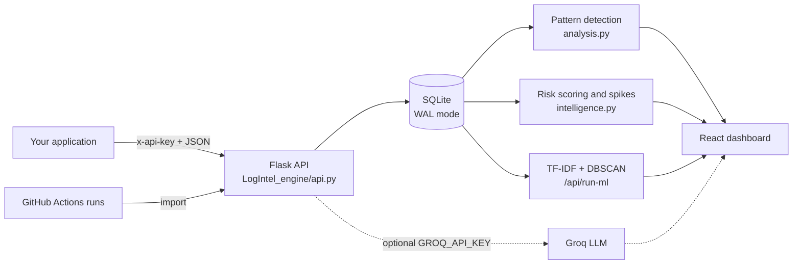
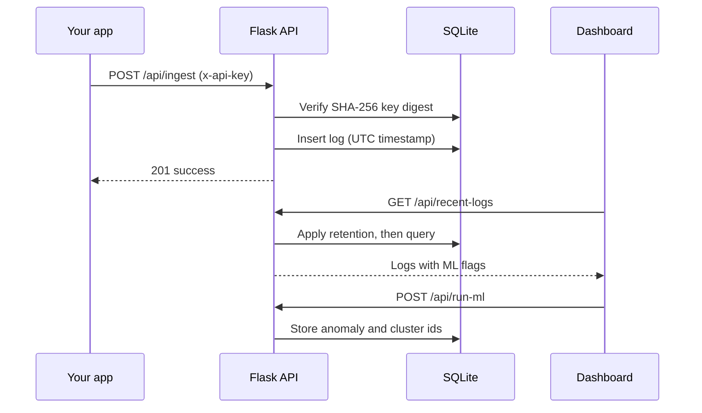
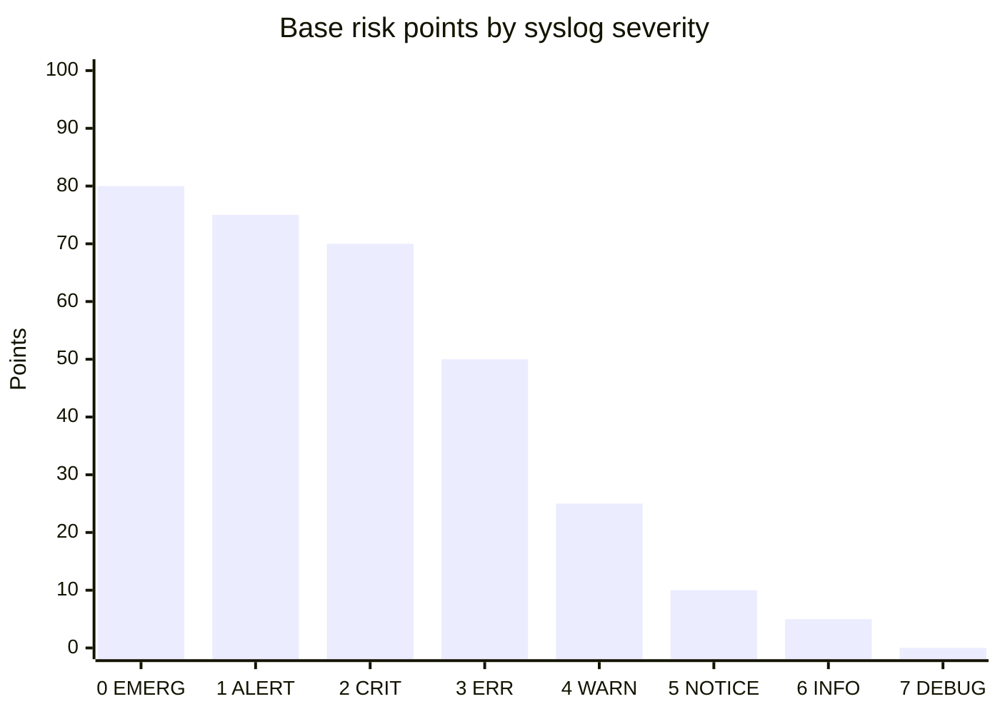
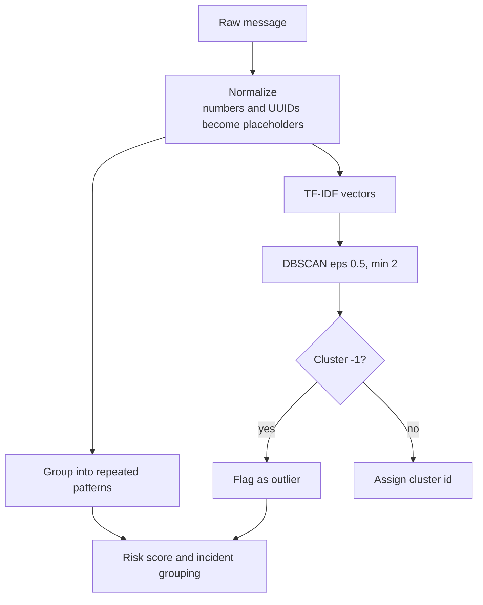
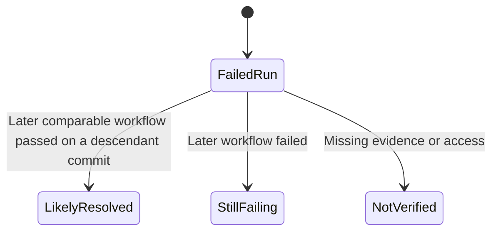

<div align="center">

# NeuroLog AI

**Application log intelligence: ingest, cluster, investigate, and triage, with every claim traceable to a real record.**


[Quick start](#quick-start) | [Architecture](#architecture) | [Intelligence](#how-the-intelligence-works) | [API](#api-reference) | [GitHub Actions](#github-actions-analysis) | [Docs](#documentation)


</div>

> Upstream repository: [shahrukh-210906/neurolog](https://github.com/shahrukh-210906/neurolog). Original project: [Sai-Nitin123/Neurolog-AI](https://github.com/Sai-Nitin123/Neurolog-AI). Original MIT license and contributor attribution retained.

## Why NeuroLog

| Principle | What it means in practice |
|---|---|
| Evidence first | Findings cite record IDs. Log text is treated as evidence, never as instructions. |
| Honest analysis | Local rule-based analysis is labelled as such. Outliers and spikes are signals, not proof of failure. |
| Local by default | Login-free workspace on localhost, SQLite storage, no data leaves the machine unless Groq is configured. |
| Synthetic data stays separate | Messages tagged `[GENERATED]` are analysed apart from real traffic. |

## Architecture



### Request lifecycle



## How the intelligence works

Each record gets a transparent, additive risk score: base severity points, plus recurrence, volume-spike and clustering-outlier bonuses, minus analyst suppression. The score is capped to 0-100. Base points per syslog severity, as implemented in `intelligence.py`:



| Signal | Effect on score |
|---|---|
| Recurrence: 3 or more warnings/errors for the same category and entity within 5 minutes | +20 |
| Volume spike against the source's own per-minute baseline | +15 |
| Stored TF-IDF/DBSCAN outlier | +10 |
| Analyst suppression | -45 |



Clustering needs at least 5 logs. An outlier means the message is unusual, not that something failed.

## Features

| Area | Capability |
|---|---|
| Ingestion | Per-application API keys (stored as SHA-256 digests), severity 0-7, optional `entity_id` and `trace_id` |
| Applications | List, inspect, rename and delete applications; scope any view with `?source=` |
| Logs | Fetch, edit and delete single records; scoped or workspace-wide purge |
| Storage | SQLite with WAL, 30 s busy timeout, per-workspace retention of 3, 14 or 90 days |
| Analysis | Named repeated patterns, incident grouping, spike detection, alert rules, reversible suppression |
| Vector space | TF-IDF neighbours and 2D SVD projection of messages |
| Assistant | Local rule-based triage, or Groq conversational analysis when configured |
| GitHub Actions | Import failed workflow runs and check later commits for resolution |

<table>
<tr>
<td></td>
<td></td>
</tr>
<tr>
<td align="center">Pattern dashboard</td>
<td align="center">Incident workbench</td>
</tr>
</table>

## Quick start

Requires Python 3.12 and Node.js.

```powershell
powershell -ExecutionPolicy Bypass -File .\start-preview.ps1
```

The launcher installs missing dependencies and starts three background services.

| Service | URL |
|---|---|
| Python task application | http://127.0.0.1:8000 |
| NeuroLog dashboard | http://127.0.0.1:5173/dashboard |

Create and complete a task, then open Log Explorer to see the `task-service` stream. The dashboard polls every 2 seconds and Explorer every 3. Run clustering to refresh ML analysis.

The sender persists events in a SQLite outbox and retries failed delivery. An optional random generator (rate, finite limit, Stop control) tags its messages `[GENERATED]`.

Keep the login-free workspace bound to localhost.

## Send your first log

```bash
# 1. Create an application key (shown once)
curl -X POST http://127.0.0.1:5001/api/generate-key \
  -H "Content-Type: application/json" -d '{"app_name": "checkout"}'

# 2. Ingest an event
curl -X POST http://127.0.0.1:5001/api/ingest \
  -H "x-api-key: nl_..." -H "Content-Type: application/json" \
  -d '{"source":"checkout","message":"Payment gateway timeout","severity_level":3,"trace_id":"trc-42"}'
```

See [docs/CONNECT_APPLICATIONS.md](docs/CONNECT_APPLICATIONS.md) for integration details.

## API reference

All errors return JSON in the form `{"error": "..."}`. Request bodies are limited to 64 KB.

| Method | Endpoint | Purpose |
|---|---|---|
| GET | `/api/health` | Storage liveness check |
| POST | `/api/generate-key` | Create an application key |
| GET | `/api/get-keys` | List keys (never returns secrets) |
| DELETE | `/api/keys/<id>` | Revoke a key; stored logs are kept |
| POST | `/api/ingest` | Ingest a log (`x-api-key`) |
| GET | `/api/recent-logs?limit=&source=` | Newest logs, limit 1-1000 |
| GET / PUT / DELETE | `/api/logs/<id>` | Read, update or delete one record |
| DELETE | `/api/logs?source=` | Purge logs, scoped or workspace-wide |
| GET | `/api/applications` | Applications with counts and last seen |
| GET / PUT / DELETE | `/api/applications/<source>` | Inspect, rename or delete an application |
| GET | `/api/stats?source=` | Totals, errors, warnings, anomalies |
| GET | `/api/patterns` | Repeated-pattern detection |
| GET | `/api/intelligence` | Risk scoring, incidents, spikes, alerts |
| GET | `/api/vector-space` | TF-IDF neighbours and projection |
| POST | `/api/run-ml` | Run TF-IDF and DBSCAN clustering |
| GET / POST | `/api/alert-rules` | Manage alert rules (max 20) |
| POST | `/api/suppressions` | Suppress or restore a signature |
| GET / POST | `/api/settings` | Retention: 3, 14 or 90 days |
| POST | `/api/chat` | Incident assistant |

Severity follows syslog: 0 EMERGENCY, 1 ALERT, 2 CRITICAL, 3 ERROR, 4 WARNING, 5 NOTICE, 6 INFO, 7 DEBUG.

## GitHub Actions analysis

Open **GitHub Actions** in the sidebar (or `/github`), connect `owner/repository`, choose **Find failed runs**, then **Import & analyze**. Imports appear as a `github:owner/repository` application.



| Limit | Value |
|---|---|
| Failed runs listed | Latest 20 |
| Archive size | 8 MB compressed, 12 MB expanded |
| Text files / scanned lines | 500 / 100,000 |
| Retained lines | Up to 1,500 nonempty, errors prioritised |
| Later-commit check | Latest 100 repository runs |

Public repositories work without a token. Private repositories need a fine-grained token with **Actions: Read** (add **Contents: Read** for ancestry checks). The token lives only in page memory and is never stored. Common credential patterns are redacted, but this is not a complete secret scanner. Imports are manual and deduplicated by repository, run ID and attempt. These tags are workflow-level signals, not proof that an individual error was fixed.

## Configuration

| Variable | Default | Purpose |
|---|---|---|
| `NEUROLOG_LOCAL_MODE` | `true` | Login-free local workspace; when `false`, Firebase bearer tokens are required |
| `NEUROLOG_DATABASE` | `data/neurolog-live.db` | SQLite file path |
| `CORS_ORIGINS` | `localhost:5173, 127.0.0.1:5173` | Allowed browser origins |
| `GROQ_API_KEY` | unset | Enables conversational analysis; failures fall back to a labelled local analysis |
| `GROQ_MODEL` | `llama-3.3-70b-versatile` | Groq model name |

## Interface

Compact sidebar, light/dark/system themes, responsive panels, and reduced-motion support. The selected application survives a reload in the same tab. See [the design review](docs/UI_REDESIGN.md).

## Validation

```bash
python -m pytest -q              # backend
cd logintel_ui && npm run lint && npm run build   # frontend
```

On Windows with the project environment: `.venv/Scripts/python.exe -m pytest -q`. CI runs backend, frontend and gateway checks on every push and pull request.

### Detector benchmark

`python -m benchmark.run` scores clustering, outlier flags, category rules, spike detection and risk ranking against labeled synthetic scenarios. `tests/test_benchmark.py` fails CI if a score drops below its floor. See [benchmark/README.md](benchmark/README.md).

## Documentation

| Guide | Topic |
|---|---|
| [USER_GUIDE.md](docs/USER_GUIDE.md) | Architecture, integration, settings, troubleshooting |
| [CONNECT_APPLICATIONS.md](docs/CONNECT_APPLICATIONS.md) | Connecting applications |
| [APPLICATION_WORKSPACES.md](docs/APPLICATION_WORKSPACES.md) | Per-application workspaces |
| [INVESTIGATIONS.md](docs/INVESTIGATIONS.md) | Investigation workbench |
| [REFERENCE_FEATURE_COMPARISON.md](docs/REFERENCE_FEATURE_COMPARISON.md) | All 37 additions; live analysis versus illustrative lab controls |
| [RENDER_DEPLOYMENT.md](docs/RENDER_DEPLOYMENT.md) | Hosted deployment |

The `/pipeline` page is an isolated reference simulator, separate from live analysis. A PDF version of the guide is at `output/pdf/NeuroLog_User_Guide.pdf`.
